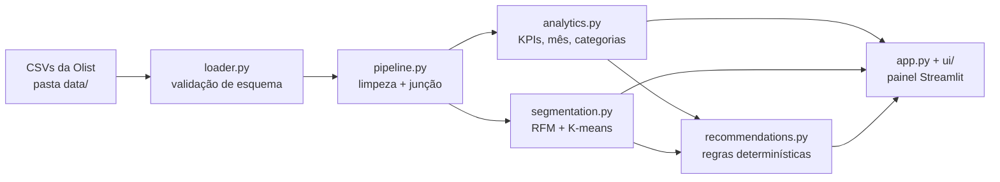

# Unidata

> **Unidata** (nome de trabalho do MVP: *E-commerce Insights*) é um painel analítico em português brasileiro que transforma os arquivos transacionais da base pública da Olist em indicadores, sazonalidade mensal, segmentos de clientes (RFM + K-means) e recomendações explicáveis para apoiar decisões de campanha.

Projeto acadêmico de Big Data desenvolvido em formato *Spec-Driven Development* (SDD): a especificação (`spec.md`, `requirements.md`, `design.md`, `tasks.md`) vem antes do código, e cada regra de cálculo abaixo é rastreável a ela.

---

## Sumário

1. [Resumo](#resumo)
2. [Qual problema resolve](#qual-problema-resolve)
3. [Funcionalidades](#funcionalidades)
4. [Como instalar e executar](#como-instalar-e-executar)
5. [Fluxo de dados e infraestrutura](#fluxo-de-dados-e-infraestrutura)
6. [Metodologia](#metodologia)
7. [Estrutura do repositório](#estrutura-do-repositório)
8. [Testes](#testes)
9. [Tratamento de falhas](#tratamento-de-falhas)
10. [Limitações](#limitações)
11. [Apresentação do projeto](#apresentação-do-projeto)
12. [Fonte dos dados, licença e atribuição](#fonte-dos-dados-licença-e-atribuição)

---

## Resumo

O Unidata lê localmente cinco arquivos CSV da Olist, valida o esquema, junta as tabelas sem duplicar receita e calcula:

- **KPIs**: receita de produtos (sem frete), pedidos entregues, clientes únicos e ticket médio por pedido;
- **Sazonalidade**: série mensal ordenada cronologicamente (receita, pedidos e ticket médio);
- **Categorias**: ranking por receita, com itens e pedidos distintos;
- **Clientes**: tabela RFM e 4 segmentos obtidos com K-means, com perfil numérico de cada segmento;
- **Recomendações**: texto cauteloso gerado por regras determinísticas, sempre acompanhado da evidência numérica e de uma ressalva.

A interface é um painel Streamlit escuro (canvas `#000000`, superfícies `#040910`/`#0d0d0d`, azul `#0063e1`), descrito em [`design.md`](design.md).

> **Nota sobre a skill Impeccable:** a skill Impeccable não estava disponível no ambiente de desenvolvimento e, por isso, não foi executada. A interface seguiu apenas o `design.md`. Se você tiver essa skill instalada no seu agente, pode rodá-la sobre `app.py` e `src/unidata/ui/` para uma revisão adicional de design.

## Qual problema resolve

Os registros de e-commerce ficam espalhados em várias tabelas (pedidos, itens, clientes, produtos, pagamentos) e **não mostram diretamente** quais clientes priorizar, quando as vendas foram maiores ou quais categorias destacar. Somar tabelas sem cuidado também gera erros típicos:

| Armadilha comum | Como o Unidata evita |
|---|---|
| Somar `payment_value` junto com `price` duplica receita (parcelas, vouchers, itens múltiplos) | Receita de produtos = soma de `price` dos itens de pedidos `delivered`, **sem** frete e **sem** a tabela de pagamentos |
| Usar `customer_id` como identidade de cliente | Clientes únicos contados por `customer_unique_id` |
| Rotular clusters pelo número que o K-means devolve | Rótulos criados **depois** do ajuste, a partir do perfil observado (recência, frequência e gasto) |
| Apresentar padrão histórico como previsão | Linguagem cautelosa (“considere”, “avalie”, “indica”) e ressalva em cada recomendação |

O público-alvo é um analista de e-commerce ou de negócio. O produto **não** dispara campanhas, **não** prevê vendas futuras e **não** afirma representar todo o comércio eletrônico brasileiro.

## Funcionalidades

| Funcionalidade | Onde está | Situação |
|---|---|---|
| Carga e validação de esquema dos CSVs, com instruções de download quando faltam arquivos | `src/unidata/loader.py` | Implementado e testado |
| Limpeza e junção relacional sem duplicação de receita | `src/unidata/pipeline.py` | Implementado e testado |
| KPIs, série mensal (com variação ano a ano) e ranking de categorias | `src/unidata/analytics.py` | Implementado e testado |
| RFM + K-means (`k=4`, `StandardScaler`, `random_state=42`, `n_init=10`) | `src/unidata/segmentation.py` | Implementado e testado |
| Recomendações determinísticas com evidência e ressalva | `src/unidata/recommendations.py` | Implementado e testado |
| Painel Streamlit com filtros de ano/mês, gráficos e estados de erro | `app.py`, `src/unidata/ui/` | Implementado e testado |
| Formatação BRL e datas em português | `src/unidata/formatting.py` | Implementado e testado |

## Como instalar e executar

### Pré-requisitos

- Python 3.11 ou superior (o projeto foi desenvolvido e testado com Python 3.13);
- Git.

### 1. Clonar e criar o ambiente

```bash
git clone <URL-DO-SEU-REPOSITORIO> unidata
cd unidata

python -m venv .venv
# Windows (PowerShell)
.venv\Scripts\Activate.ps1
# Linux / macOS
source .venv/bin/activate

pip install -r requirements.txt
```

### 2. Baixar a base da Olist (manual)

Os CSVs **não são versionados** (licença CC BY-NC-SA 4.0) e o download no Kaggle exige login.

1. Acesse <https://www.kaggle.com/datasets/olistbr/brazilian-ecommerce> e baixe o conjunto.
2. Copie estes arquivos para a pasta `data/` na raiz do projeto:

| Arquivo | Obrigatório |
|---|---|
| `olist_orders_dataset.csv` | Sim |
| `olist_order_items_dataset.csv` | Sim |
| `olist_customers_dataset.csv` | Sim |
| `olist_products_dataset.csv` | Sim |
| `product_category_name_translation.csv` | Não (traduz o nome das categorias) |

Para usar outra pasta, defina a variável de ambiente `UNIDATA_DATA_DIR`:

```bash
# Windows (PowerShell)
$env:UNIDATA_DATA_DIR = "C:\caminho\para\os\csvs"
# Linux / macOS
export UNIDATA_DATA_DIR=/caminho/para/os/csvs
```

### 3. Abrir o painel

```bash
streamlit run app.py
```

O painel abre em <http://localhost:8501>. Se algum arquivo estiver faltando, a própria tela lista exatamente quais são e onde colocá-los, sem mostrar traceback.

## Fluxo de dados e infraestrutura

O Unidata é um **aplicativo local de processo único**: não há servidor de banco de dados, API externa, autenticação nem persistência. Os CSVs são lidos do disco, processados em memória com pandas e exibidos pelo Streamlit.



| Camada | Tecnologia | Papel |
|---|---|---|
| Ingestão | pandas | Leitura dos CSVs, tipagem, validação de colunas e mensagens de onboarding |
| Transformação | pandas | Filtra `delivered`, deriva o ano-mês de `order_purchase_timestamp` e junta itens, pedidos, clientes e produtos |
| Segmentação | scikit-learn | `StandardScaler` + `KMeans` sobre recência, `log1p(frequência)` e `log1p(gasto)` |
| Interface | Streamlit + Plotly | Painel responsivo, gráficos com tooltip e estados de carregamento/erro/vazio |
| Cache | `st.cache_data` | A base só é recarregada quando o instantâneo dos arquivos (caminho, data de modificação, tamanho) muda; filtros reutilizam o resultado |
| Qualidade | pytest + Playwright | Testes unitários, de integração e ponta a ponta (navegador) sobre fixtures sintéticas |

A lógica de cálculo fica em `src/unidata/` e **não** depende do Streamlit, de modo que pode ser testada isoladamente.

## Metodologia

- **Universo**: apenas pedidos com status `delivered`. Data de compra = `order_purchase_timestamp`.
- **Receita de produtos**: soma de `price` dos itens. Frete e `payment_value` ficam de fora. Valores em BRL são nominais do período (sem correção inflacionária).
- **Pedidos**: `order_id` distintos. **Ticket médio** = receita de produtos ÷ pedidos entregues do mesmo recorte.
- **Clientes**: `customer_unique_id` distintos.
- **Sazonalidade**: agregação por `YYYY-MM`, em ordem cronológica. É um padrão histórico observado, sem previsão.
- **RFM**: uma linha por `customer_unique_id`.
  - *Recência*: dias entre a maior data de compra observada na base e a última compra do cliente (não a data atual).
  - *Frequência*: pedidos distintos. *Monetário*: soma de `price`.
  - `log1p` em frequência e gasto para reduzir assimetria, depois `StandardScaler`.
- **K-means**: `k=4`, `random_state=42`, `n_init=10`. Se não houver clientes suficientes (mínimo de 4) ou o ajuste falhar, o painel mostra um erro interpretável e mantém KPIs e sazonalidade.
- **Rótulos de segmento**: criados após o ajuste, a partir de recência, frequência e gasto medianos. Os IDs numéricos do cluster não têm significado de negócio.
- **Recomendações**: regras fixas por tipo (Clientes, Sazonalidade, Produtos), com evidência numérica, período e ressalva de que o padrão é histórico e não prova causalidade. Sem evidência suficiente, nenhuma recomendação é gerada.

## Estrutura do repositório

```text
.
├── app.py                      # Ponto de entrada do painel Streamlit
├── requirements.txt
├── .streamlit/config.toml      # Tema escuro do painel
├── data/                       # CSVs da Olist (não versionados; só .gitkeep)
├── src/unidata/
│   ├── config.py               # Constantes, esquemas e parâmetros do K-means
│   ├── loader.py               # Carga e validação dos CSVs
│   ├── pipeline.py             # Limpeza e junções
│   ├── analytics.py            # KPIs, série mensal, categorias
│   ├── segmentation.py         # RFM + K-means
│   ├── recommendations.py      # Recomendações explicáveis
│   ├── formatting.py           # BRL, datas e números em pt-BR
│   └── ui/                     # Tema, gráficos e seções do painel
├── tests/                      # Testes unitários + fixtures sintéticas
│   └── e2e/                    # Testes ponta a ponta em 4 níveis
├── presentation/               # Apresentação do projeto (HTML autocontido)
├── spec.md · requirements.md · design.md · tasks.md   # Especificação (SDD)
└── README.md
```

## Testes

```bash
# Testes unitários e de integração (rápidos, sem navegador)
python -m pytest -m "not ui"

# Suíte completa, incluindo o painel em navegador real
# (requer Google Chrome ou Microsoft Edge instalado; os testes detectam o executável automaticamente)
python -m pytest
```

Os testes usam **apenas fixtures sintéticas** (`tests/fixtures/`, `tests/e2e/fixtures/`), que cobrem pedidos com vários itens, vários registros de pagamento, `customer_unique_id` repetido e categorias nulas ou sem tradução. Nenhum teste depende dos dados reais da Olist.

## Tratamento de falhas

| Situação | Comportamento |
|---|---|
| Arquivos ausentes | Lista os arquivos esperados e explica como baixar e posicionar a base |
| Coluna obrigatória ausente | Informa o arquivo e a coluna esperada |
| CSV inválido ou com encoding errado | Mensagem clara, sem traceback |
| Sem pedidos entregues ou filtro sem dados | Estado vazio explicado, com opção de limpar o filtro |
| Falha no K-means | KPIs e sazonalidade continuam disponíveis; a seção de clientes informa o erro |

## Limitações

- A base cobre aproximadamente **setembro de 2016 a setembro de 2018** e vem de **um marketplace (Olist)**: não representa todo o e-commerce brasileiro.
- O painel descreve o passado; **não prevê** vendas nem prova causalidade.
- `k=4` é fixo por decisão de projeto (evita seleção automática opaca); clusters são uma partição estatística, não “grupos naturais”.
- Valores monetários são nominais, sem correção inflacionária.
- O painel não aceita upload de outra base nem atualização automática.
- Os testes automatizados usam dados sintéticos; as métricas reais dependem dos CSVs que você baixar.

## Apresentação do projeto

A pasta [`presentation/`](presentation/) contém uma apresentação interativa autocontida, no estilo da skill [`project-showcase`](https://github.com/isjoaovictor/project_showcase_skill). Abra `presentation/showcase.html` no navegador (sem servidor e sem dependências externas). Ela segue a estrutura:

1. Introdução · 2. Objetivos · 3. Fundamentação teórica · 4. Metodologia / pipeline de dados · 5. Ferramentas utilizadas · 6. Resultados obtidos · 7. Discussão e limitações · 8. Conclusão e referências.

Os números mostrados na apresentação vêm da **fixture sintética de teste**, com rótulo visível, e não de dados reais da Olist. Veja `presentation/SOURCES.md` e `presentation/README.md`.

## Fonte dos dados, licença e atribuição

- **Dados**: Olist, *Brazilian E-Commerce Public Dataset by Olist*, Kaggle — <https://www.kaggle.com/datasets/olistbr/brazilian-ecommerce>.
- **Licença dos dados**: [CC BY-NC-SA 4.0](https://creativecommons.org/licenses/by-nc-sa/4.0/). **Uso exclusivamente não comercial**, com atribuição e compartilhamento pela mesma licença. Este repositório **não redistribui** os CSVs.
- **Código**: licença MIT (ver [`LICENSE`](LICENSE)), restrita ao código deste repositório. Ela não se aplica aos dados da Olist.
- Os registros da Olist são anonimizados. Não tente reidentificar clientes, lojas ou pedidos.
